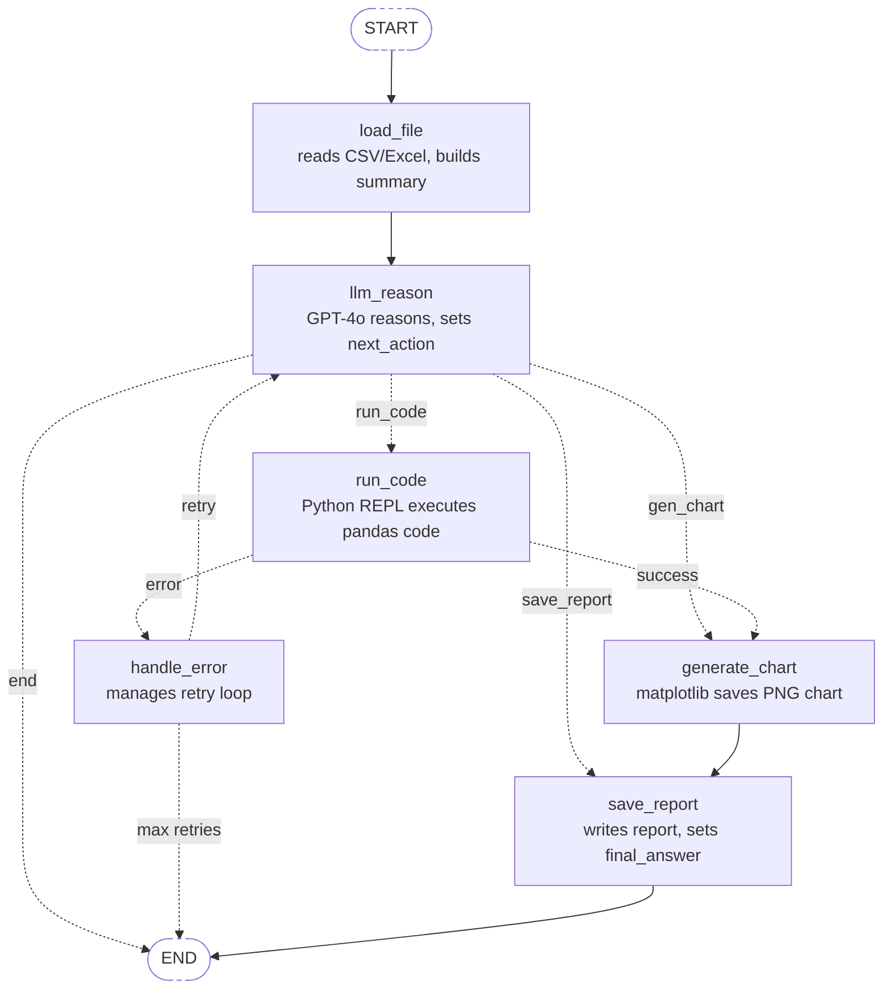

# Data Analyst AI Agent

An autonomous AI agent that analyses CSV and Excel files, executes real Python code, and generates visual charts — built with **LangGraph**, **LangChain**, and **GPT-4o**.

> Give it a messy bank statement or stock data file. Ask it a question in plain English. It writes and runs its own pandas code, draws charts, and saves a full report — all automatically.

---

## What It Does

- Loads any **CSV or Excel** file automatically
- Understands the data structure before writing any code
- Writes and **executes real Python / pandas code** live
- Generates **matplotlib / seaborn charts** saved as PNG
- Retries automatically if its own code throws an error (up to 3 times)
- Saves a plain-English **analysis report** to disk
- Loops so you can ask multiple questions in one session

---

## Demo

```
╔══════════════════════════════════════════════════════╗
║       DATA ANALYST AI AGENT                          ║
║       Powered by LangGraph + GPT-4o                  ║
╚══════════════════════════════════════════════════════╝

▶ Select your data file
  1. bank_statement.csv  .CSV  0.7 KB

  Enter file number: 1

▶ What would you like to know?
  Your question: What category did I spend the most on?

  ✓ Loading data file           (0.3s)
    SHAPE: 15 rows × 4 columns
  ✓ LLM reasoning (GPT-4o thinking...)  (2.1s)
  ✓ Executing Python code       (2.4s)
    Rent    1200.0
    Groceries  157.8
  ✓ Generating chart            (5.2s)
    Saved: outputs/chart_20260414_112300.png
  ✓ Writing analysis report     (7.8s)

  ANSWER: Rent was the highest spending category at PKR 1,200.00

  KEY FINDINGS:
  • Rent: PKR 1,200.00 — 67.1% of total spend
  • Groceries: PKR 157.80 — 8.8%
  • Total monthly spending: PKR 1,787.53
```

---

## Agent Architecture

This agent is built as a **LangGraph state graph** — not a simple chain. Every step is a node. State flows between nodes through a shared `AnalystState` dictionary. The LLM decides at runtime which path to take next.



### The 6 Nodes

| Node | File | What It Does |
|---|---|---|
| `load_file` | `nodes.py` | Reads CSV/Excel with pandas, builds text summary for LLM |
| `llm_reason` | `nodes.py` | GPT-4o reads the summary and question, writes Python code, sets `next_action` |
| `run_code` | `nodes.py` | Executes LLM-written code in Python REPL, captures printed output |
| `generate_chart` | `nodes.py` | LLM writes matplotlib code, tool saves it as PNG |
| `save_report` | `nodes.py` | LLM writes plain-English summary, saved as .txt |
| `handle_error` | `nodes.py` | Catches exceptions, increments retry counter, loops back to LLM with error context |

### The 4 Tools

| Tool | What It Does |
|---|---|
| `load_file_tool` | Reads CSV/Excel, returns structured text summary |
| `python_repl_tool` | Live Python interpreter — runs pandas, numpy, any code |
| `generate_chart_tool` | Executes matplotlib/seaborn code, saves PNG to `outputs/` |
| `save_report_tool` | Writes timestamped text report to `outputs/` |

---

## Quickstart

### 1. Clone the repo

```bash
git clone https://github.com/YOUR_USERNAME/data-analyst-agent.git
cd data-analyst-agent
```

### 2. Create a virtual environment

```bash
python -m venv venv

# Windows
venv\Scripts\activate

# macOS / Linux
source venv/bin/activate
```

### 3. Install dependencies

```bash
pip install -r requirements.txt
```

### 4. Set your API key

Open `.env` and paste your OpenAI API key:

```env
OPENAI_API_KEY=sk-proj-your-key-here
OPENAI_MODEL=gpt-4o
MAX_RETRIES=3
TEMPERATURE=0
```

> Get your key at [platform.openai.com/api-keys](https://platform.openai.com/api-keys)

### 5. Add your data file

Drop any `.csv` or `.xlsx` file into the `data/` folder. A sample bank statement is included to test with immediately.

### 6. Run the agent

```bash
python main.py
```

---

## Example Questions to Ask

Once running, you can ask questions like:

```
What category did I spend the most on?
Show me a breakdown of all spending by category
What was my total spending this month?
Which day had the highest transaction?
Show me the top 5 most expensive transactions
What percentage of my spending was on food?
Give me a monthly trend of my expenses
```

---

## Configuration

All settings live in `.env`:

| Variable | Default | Description |
|---|---|---|
| `OPENAI_API_KEY` | — | Your OpenAI API key (required) |
| `OPENAI_MODEL` | `gpt-4o` | Model to use. `gpt-4-turbo` also works |
| `MAX_RETRIES` | `3` | How many times agent retries on code error |
| `TEMPERATURE` | `0` | LLM randomness. Keep at 0 for code generation |
| `DATA_FOLDER` | `data` | Folder to look for input files |
| `OUTPUT_FOLDER` | `outputs` | Folder to save charts and reports |

---

## The State — How Data Flows

Every node reads from and writes to a shared `AnalystState` dictionary. No node talks directly to another — they communicate only through state.

```python
class AnalystState(TypedDict):
    # Set by user at start
    file_path:          str
    user_question:      str

    # Filled by load_file node
    dataframe_summary:  Optional[str]   # column names, types, sample rows
    raw_data_info:      Optional[str]   # null counts, unique values

    # Filled by llm_reason node
    code_to_run:        Optional[str]   # Python code LLM wrote
    next_action:        Optional[str]   # routing: run_code / gen_chart / save_report / end

    # Filled by run_code node
    code_output:        Optional[str]   # printed output from REPL
    error_message:      Optional[str]   # exception text if code crashed

    # Filled by output nodes
    chart_path:         Optional[str]   # path to saved PNG
    final_answer:       Optional[str]   # complete response shown to user

    # Control fields
    retry_count:        Optional[int]   # incremented by handle_error node
    messages:           Optional[list]  # full LLM conversation history
```

---

## The Retry Loop

One of the most powerful features. If the LLM writes buggy pandas code:

```
run_code_node
  → code crashes → KeyError: 'Category'
  → handle_error_node increments retry_count
  → routes back to llm_reason_node
  → LLM reads error_message: "KeyError: 'Category'"
  → LLM reads original column names from dataframe_summary
  → LLM writes corrected code with exact column name
  → run_code_node executes successfully
  → continues to generate_chart_node
```

This self-correction loop runs up to `MAX_RETRIES` times before giving up gracefully.

---

## Requirements

```
Python 3.10+
langgraph==0.2.55
langchain==0.3.13
langchain-openai==0.2.14
langchain-experimental==0.3.4
pandas==2.2.3
openpyxl==3.1.5
matplotlib==3.9.4
seaborn==0.13.2
python-dotenv==1.0.1
```

Full list in `requirements.txt`.

---

## What You Will Learn From This Project

- How **LangGraph state graphs** work — nodes, edges, conditional routing
- The **ReAct agent pattern** — Reason → Act → Observe → loop
- How to give an AI agent **real Python execution** capabilities
- How to build **self-correcting agents** with retry loops
- How to structure a **production-quality agent project**
- How **tools** bridge the gap between LLM text output and real actions
- How to design a **shared state schema** that flows cleanly between nodes

---

## Extending This Agent

Some ideas for taking this further:

- **Add MCP servers** — wrap the tools as MCP servers so any agent framework can use them
- **Add web search** — let the agent look up stock prices or company info while analysing
- **Add memory** — use a vector database to remember previous analyses
- **Multi-file analysis** — let the agent compare two files side by side
- **Upgrade to multi-agent** — add a Critic agent that reviews the analysis before saving
- **Add a Streamlit UI** — replace the terminal interface with a web app

---

## .gitignore

Make sure your `.gitignore` includes:

```
.env
__pycache__/
*.pyc
outputs/
.venv/
venv/
*.egg-info/
.DS_Store
```

---

## License

MIT License — free to use, modify, and distribute.

---

## Built With

- [LangGraph](https://github.com/langchain-ai/langgraph) — agent state graph framework
- [LangChain](https://github.com/langchain-ai/langchain) — tools, prompts, LLM wrappers
- [OpenAI GPT-4o](https://platform.openai.com) — the reasoning brain
- [pandas](https://pandas.pydata.org) — data manipulation
- [matplotlib](https://matplotlib.org) + [seaborn](https://seaborn.pydata.org) — charting

---

*Built as a hands-on learning project for understanding AI agent architecture with LangGraph.*
